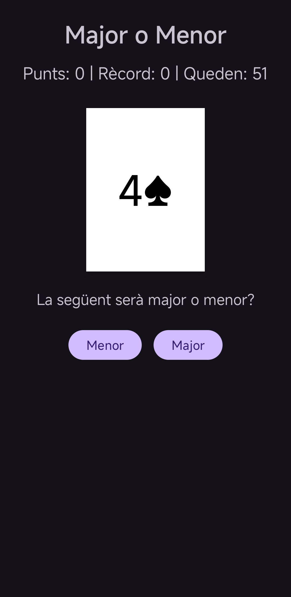
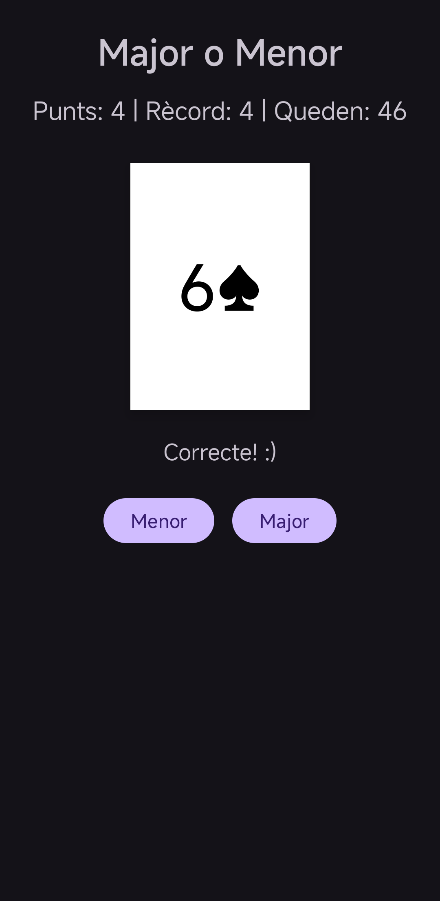
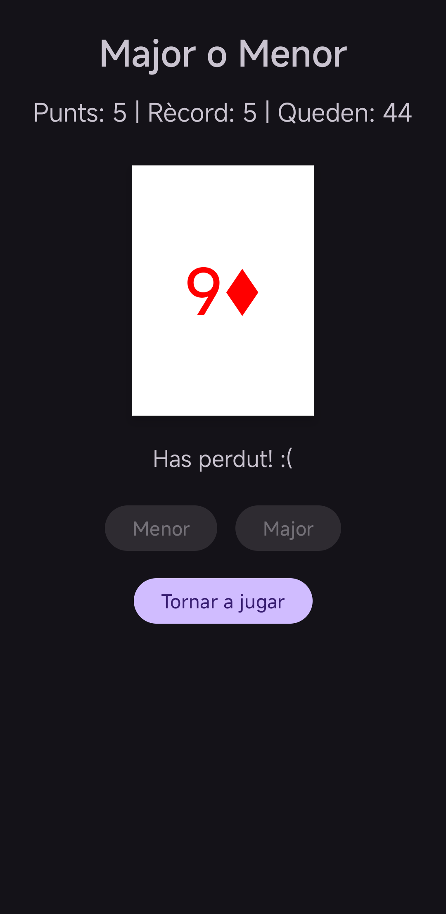
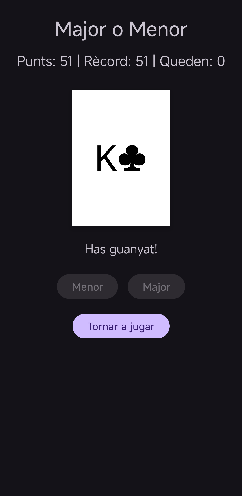

# Higher or Lower
Simple card game made with Kotlin and XML. A card from a 52-card deck is shown and you have to guess if the next one will be higher or lower. Every correct guess adds a point; if you fail, the game is over. If you get through the whole deck, you win.

## Screenshots

| Home | Playing |
|---|---|
|  |  |
| **Lost** | **Win** |
|  |  |
